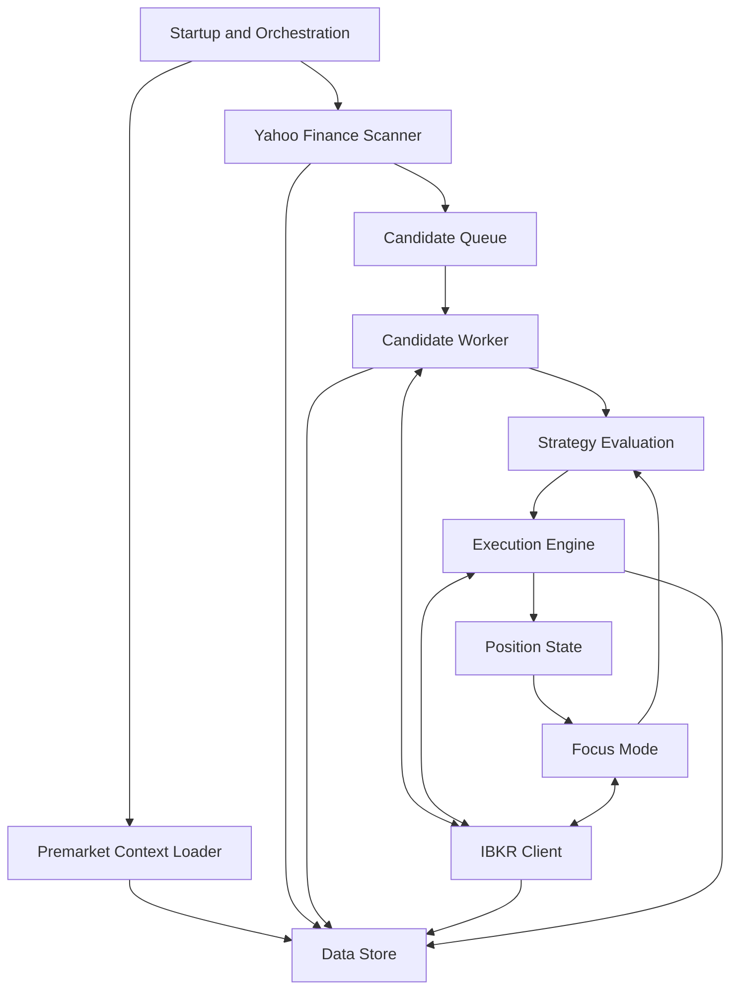

# Automated Intraday Trading Engine — Architecture

> **Project status: Under development.** This repository documents the architecture and selected implementation examples of an automated intraday trading system. It is not a production-validated autonomous trading system. No claim is made regarding profitability, operational readiness, or suitability for live trading.

## Overview

A modular Python project exploring automated intraday trading of US-listed equities. Its components cover market-data collection, candidate screening, asynchronous evaluation, Interactive Brokers (IBKR) connectivity, order execution, position monitoring, and data persistence.

The public repository includes selected Python implementation examples to demonstrate software architecture, modular design, data processing, asynchronous task coordination, and execution-system integration.

The examples do not represent the complete trading system. Proprietary strategy rules, screening criteria, trading parameters, risk-management rules, credentials, private datasets, and sensitive operational configuration are intentionally excluded.

## Architecture



Editable diagram source: [`diagrams/architecture_diagram.mmd`](diagrams/architecture_diagram.mmd).

## Project Structure

The following illustrates the main project directory and the organisation of its application modules, strategies, configuration, utilities, and generated data.

```text
C:\Intraday_Trading_Engine\
│
├── core/
│   ├── yahoo_scanner.py
│   │   # Continuous Yahoo scanner → Strategy1
│   ├── candidate_queue.py
│   │   # Thread-safe in-memory candidate queue
│   ├── candidate_worker.py
│   │   # Consumes queue → Strategy2 → BUY
│   │   # - Logs exceptions in raw snapshot and intraday saves
│   │   # - Ensures New York timezone for intraday Datetime
│   │   # - Executes at most one BUY per cycle
│   │   # - Skips Strategy2 if cached result exists
│   │   # - Uses global multi-candidate filtering and ranking
│   │   #   (Step1 / Step2 / fallback)
│   │   # - Returns executed BUY information dictionary or None
│   ├── ibkr_client.py
│   │   # IBKR connection, streaming, and asynchronous data fetch
│   ├── focus_mode.py
│   │   # Trade monitoring and exit logic via Strategy3
│   └── execution_engine.py
│       # Order execution logic via IBKR and trade logging
│
├── strategies/
│   ├── strategy1.py
│   │   # Yahoo signal detection logic (5-minute bars)
│   ├── strategy2.py
│   │   # IBKR confirmation logic (live / historical bars)
│   └── strategy3.py
│       # Exit logic placeholder / stop-loss / take-profit
│
├── config/
│   ├── settings.py
│   │   # Scan intervals, IBKR settings, logging, etc.
│   └── symbols.py
│       # Universe loader and symbol cleaner
│
├── utils/
│   ├── logging_config.py
│   │   # Logging configuration
│   └── data_store.py
│       # Thread-safe CSV / Parquet writers for:
│       # - Intraday bars
│       # - Premarket snapshots
│       # - Yahoo raw snapshots
│       # - IBKR raw snapshots
│       # - IBKR intraday snapshots
│       # - Strategy inputs (Strategy1 and Strategy2)
│       # - Trades
│
├── data/
│   # Automatically generated daily files
│   ├── intraday/
│   │   └── YYYY-MM-DD.parquet
│   ├── yahoo_raw/
│   │   └── YYYY-MM-DD.parquet
│   ├── premarket/
│   │   └── YYYY-MM-DD.parquet
│   ├── ibkr_raw/
│   │   └── YYYY-MM-DD.parquet
│   ├── ibkr_intraday/
│   │   # IBKR intraday snapshots (New York timezone normalised)
│   │   └── YYYY-MM-DD.parquet
│   ├── strategy_inputs/
│   │   ├── strategy1/
│   │   │   └── YYYY-MM-DD/
│   │   │       └── SYMBOL.parquet
│   │   └── strategy2/
│   │       └── YYYY-MM-DD/
│   │           └── SYMBOL.parquet
│   ├── candidates.csv
│   │   # Accumulated candidate signals
│   └── trades.csv
│       # Accumulated executed trades
│
└── main.py
    # Orchestrator, premarket loader, and IBKR loop
```

The `data/` directory contains runtime-generated files and is separate from the application's source-code modules. Daily files use date-based naming to organise market data and strategy inputs.

## Components

| Component | Responsibility |
|---|---|
| `main.py` | Lifecycle, scheduling, orchestration, task coordination, shutdown |
| Premarket loader | Retrieves and normalises historical market context |
| Yahoo scanner | Collects and normalises intraday data across a configured symbol universe |
| Candidate queue | Thread-safe handoff of selected symbols |
| Candidate worker | Retrieves IBKR data, evaluates candidates, coordinates selection |
| IBKR client | Broker connectivity, streaming, and historical data requests |
| Execution engine | Submits orders and monitors order status and fills |
| Focus Mode | Monitors an open position and evaluates exit conditions |
| Data store | Persists market data, strategy inputs, candidates, and trade records |
| Strategy modules | Encapsulate screening, candidate evaluation, and position-management logic |

## Workflow

1. Initialise logging, symbol universe, premarket context, IBKR connection, and background tasks.
2. Collect intraday data during the early session; first-stage screening is initially disabled.
3. Enable candidate generation during the configured mid-session window.
4. Evaluate queued candidates using IBKR five-minute bars and subsequent strategy stages.
5. On a reported entry fill, hand the position to Focus Mode; pause scanning and candidate evaluation while active.
6. On a reported exit fill, mark trading finished for the day.
7. Shut down after the configured post-market-close delay or on termination signals.

The schedule is based on New York local time and five-minute cycles. Exact strategy rules and thresholds are intentionally omitted.

## Technology

Python, `asyncio`, `pandas`, Parquet, CSV, Yahoo Finance data access, Interactive Brokers API connectivity, thread pools, locks, queues, and semaphores.

## Development Status and Known Limitations

This project is under development. The described implementation has unresolved items:

- Entry order quantity is currently 1, while Focus Mode exit quantity is currently 100.
- Order timeout handling needs robust cancellation and broker-state reconciliation.
- DataStore initialisation currently removes and recreates the data directory, risking loss of prior data.
- Premarket persistence includes a testing-symbol filter and is not a general production save path.
- Candidate cache and scanned-symbol lifecycle need auditing.
- Timestamp alignment, missing data, stale values, and historical-context selection need systematic validation.
- Logging cleanup and retention require review.
- Recovery after process, machine, network, or broker interruption is not established as production-grade.

No live-performance, backtest-performance, risk-adjusted-return, or profitability claims are made.

## Roadmap

Validate data and timestamps; audit candidate lifecycle and caching; reconcile order quantities and broker order states; add risk controls; make persistence non-destructive; test restart, disconnect, and partial-fill scenarios; and complete monitored paper-trading and independent review before any live-use decision.

See [`docs/development_roadmap.md`](docs/development_roadmap.md).

## Public Repository Scope

Selected Python implementation examples are included to demonstrate the system's architecture and software-engineering approach.

The complete trading system is not published. Proprietary strategy rules, thresholds, screening criteria, risk-management parameters, credentials, account identifiers, private configuration, historical datasets, candidate lists, and trade logs are excluded.

## Disclaimer

For software-architecture and educational discussion only. Not investment advice, a solicitation, or a recommendation to trade. Automated trading involves substantial risk. The documented system is under development and has not been represented as production-validated.
