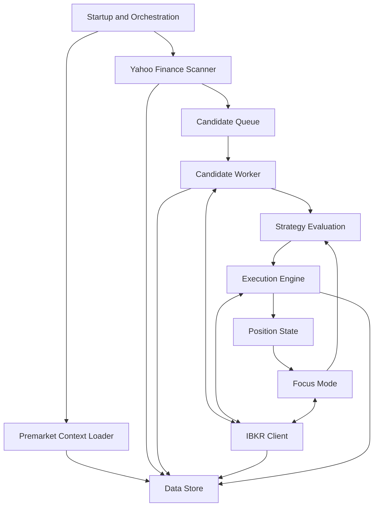

# Automated Intraday Trading Engine — Architecture

> **Project status: Under development.** This repository documents the architecture and intended workflow of an automated intraday trading system. It is not a production-validated autonomous trading system. No claim is made regarding profitability, operational readiness, or suitability for live trading.

## Overview
A modular Python project exploring automated intraday trading of US-listed equities. Its documented components cover market-data collection, candidate screening, asynchronous evaluation, Interactive Brokers (IBKR) connectivity, order execution, position monitoring, and persistence.

This is a **documentation-only** public repository. Proprietary strategy implementations, private datasets, credentials, account identifiers, and sensitive configuration are excluded.

## Architecture

Editable diagram source: [`diagrams/architecture_diagram.mmd`](diagrams/architecture_diagram.mmd).

## Components
| Component | Responsibility |
|---|---|
| `main.py` | Lifecycle, scheduling, orchestration, task coordination, shutdown |
| Premarket loader | Retrieves and normalises historical market context |
| Yahoo scanner | Collects and normalises intraday data across a configured symbol universe |
| Candidate queue | Thread-safe handoff of selected symbols |
| Candidate worker | Retrieves IBKR data, evaluates candidates, coordinates selection |
| IBKR client | Broker connectivity and historical data requests |
| Execution engine | Submits orders and monitors order status/fills |
| Focus Mode | Monitors an open position and evaluates exit conditions |
| Data store | Persists market data, strategy inputs, candidates, and trade records |
| Strategy modules | Encapsulate screening, candidate evaluation, and position-management logic |

## Workflow
1. Initialise logging, symbol universe, premarket context, IBKR connection, and background tasks.
2. Collect intraday data during the early session; first-stage screening is initially disabled.
3. Enable candidate generation during the configured mid-session window.
4. Evaluate queued candidates using IBKR five-minute bars and subsequent strategy stages.
5. On a reported entry fill, hand the position to Focus Mode; pause scanning and candidate evaluation while active.
6. On a reported exit fill, mark trading finished for the day.
7. Shut down after the configured post-market-close delay or on termination signals.

The schedule is based on New York local time and five-minute cycles. Exact strategy rules and thresholds are intentionally omitted.

## Technology
Python, `asyncio`, `pandas`, Parquet, CSV, Yahoo Finance data access, Interactive Brokers API connectivity, thread pools, locks, queues, and semaphores.

## Development status and known limitations
This project is under development. The described implementation has unresolved items:
- Entry order quantity is currently 1, while Focus Mode exit quantity is currently 100.
- Order timeout handling needs robust cancellation and broker-state reconciliation.
- DataStore initialisation currently removes and recreates the data directory, risking loss of prior data.
- Premarket persistence includes a testing-symbol filter and is not a general production save path.
- Candidate cache and scanned-symbol lifecycle need auditing.
- Timestamp alignment, missing data, stale values, and historical-context selection need systematic validation.
- Logging cleanup and retention require review.
- Recovery after process, machine, network, or broker interruption is not established as production-grade.

No live-performance, backtest-performance, risk-adjusted-return, or profitability claims are made.

## Roadmap
Validate data and timestamps; audit candidate lifecycle and caching; reconcile order quantities and broker order states; add risk controls; make persistence non-destructive; test restart/disconnect/partial-fill scenarios; and complete monitored paper-trading and independent review before any live-use decision.

See [`docs/development_roadmap.md`](docs/development_roadmap.md).

## Public repository scope
No strategy source code or proprietary thresholds, credentials, account IDs, private configuration, historical data, candidate lists, or trade logs are included.

## Disclaimer
For software-architecture and educational discussion only. Not investment advice, a solicitation, or a recommendation to trade. Automated trading involves substantial risk. The documented system is under development and has not been represented as production-validated.
